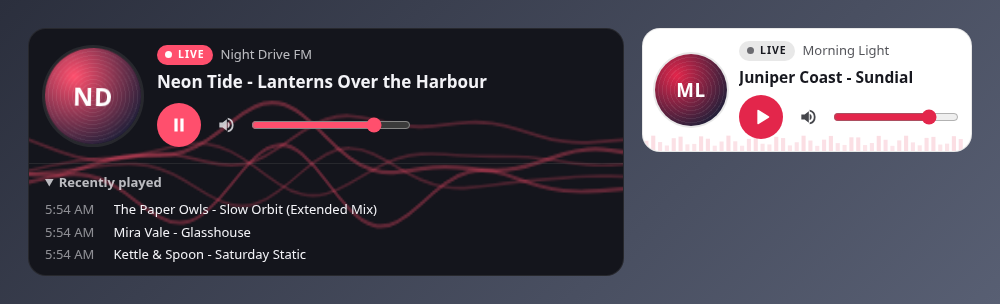

# tunein-embed

A drop-in web player for live **Icecast** and **SHOUTcast** internet radio. Paste two lines of
HTML into any page and get a player with now-playing info, album art, a live visualizer,
lock-screen controls and auto-reconnect. No framework, no build step, ~10 KB gzipped.



**[Try it with your own stream →](https://onojk.github.io/tunein-embed/demo/)**

- Plain `<audio>` playback: works on iOS Safari, Android Chrome and every desktop browser
- Now playing from Icecast `status-json.xsl`, SHOUTcast v2 `/stats` + `/currentsong`, SHOUTcast v1 `/7.html`, or your own JSON (AzuraCast, Radio.co, …)
- Recently played list, optional album art via the iTunes Search API
- Audio-reactive canvas visualizer (flowing lines or bars) that can never mute your stream
- Media Session lock-screen/notification controls with title and artwork
- Auto-reconnect with exponential backoff when the stream stalls or drops
- Shadow DOM: your site's CSS can't break it and it can't break your site
- Themeable with CSS custom properties; dark, light or auto theme; responsive from 300px to full width
- Works under a strict Content-Security-Policy (no `unsafe-inline` needed)

## Quick start

```html
<script src="https://cdn.jsdelivr.net/gh/onojk/tunein-embed@1/dist/player.js"></script>
<radio-player src="https://radio.example.com:8443/stream" title="My Station"></radio-player>
```

That's it. Your stream URL must be **https://** if your site is https (it almost certainly is),
see [CORS and HTTPS](#cors-and-https).

## Attributes

| Attribute    | Values                         | Default  | What it does |
|--------------|--------------------------------|----------|--------------|
| `src`        | stream URL                     | required | The Icecast mount or SHOUTcast stream URL. |
| `title`      | text                           | server name or "Live Radio" | Station name shown above the now-playing line. |
| `meta`       | `auto` \| `off` \| URL         | `auto`   | Where now-playing info comes from. `auto` detects Icecast / SHOUTcast v2 / v1 on the stream's server. A URL points at your own JSON endpoint (see [Custom metadata](#custom-metadata)). `off` shows the title only. |
| `poll`       | seconds                        | `15`     | How often to refresh now-playing (min 5). |
| `history`    | `off` \| `on` \| `open`        | `off`    | Show the last 10 tracks in a collapsible "Recently played" list (`open` = expanded). |
| `art`        | `itunes` \| `off`              | (logo)   | `itunes` looks up album art for each track; falls back to `logo`. `off` ignores art from custom metadata too. |
| `logo`       | image URL                      | —        | Station logo, used when there's no album art. Without one, a disc with the station initials is shown. |
| `theme`      | `dark` \| `light` \| `auto`    | `dark`   | `auto` follows the visitor's OS setting. |
| `visualizer` | `lines` \| `bars` \| `off`     | `lines`  | Canvas animation behind the player. `on` is the same as `lines`. |
| `volume`     | `0`–`1`                        | `0.8`    | Initial volume (a visitor's own choice is remembered and wins). |
| `cors`       | `auto` \| `on` \| `off`        | `auto`   | Whether to route audio through Web Audio for the live visualizer. `auto` checks the server first; `off` skips the check (no extra request); `on` skips it and assumes CORS works. |

It never autoplays: browsers block that, and visitors hate it.

## Theming

Set any of these on the element (or any ancestor):

```css
radio-player {
  --rp-accent: #19c37d;   /* buttons, LIVE badge, visualizer */
  --rp-bg: #0b1f17;       /* card background */
  --rp-fg: #eafff5;       /* text */
  --rp-font: "Inter", system-ui, sans-serif;
  --rp-radius: 8px;       /* corner radius */
}
```

For deeper changes, style the exposed parts: `radio-player::part(player)`, `::part(art)`,
`::part(badge)`, `::part(station)`, `::part(now-playing)`, `::part(play-button)`,
`::part(volume)`, `::part(message)`, `::part(history)`.

The player sizes itself to its container, not the window, so it fits a 300px sidebar or a
full-width header. `prefers-reduced-motion` turns off the spinning art, scrolling title and
visualizer animation.

## JavaScript API

```js
const player = document.querySelector('radio-player');
player.play();          // call from a click handler (browser autoplay rules)
player.pause();
player.toggle();
player.now;             // { artist, title, text, art } or null
player.history;         // previous tracks, newest first

player.addEventListener('rp-track', (e) => console.log('Now playing', e.detail));
player.addEventListener('rp-state', (e) => console.log(e.detail.state)); // idle | loading | playing | reconnecting | error
player.addEventListener('rp-error', (e) => console.warn(e.detail.message));
```

Starting one player pauses any other `<radio-player>` on the page.

## Embedding

### 1. Script tag (recommended)

As in [Quick start](#quick-start). `@1` gets every 1.x release automatically. Pin an exact
version with `@v1.0.0`, or self-host `dist/player.js` (it's a single file with no dependencies).

### 2. iframe (for builders that strip `<script>`)

WordPress.com, Squarespace, Wix, Notion, etc.:

```html
<iframe src="https://onojk.github.io/tunein-embed/embed.html?src=https%3A%2F%2Fradio.example.com%3A8443%2Fstream&title=My%20Station&theme=dark"
        style="width:100%;height:150px;border:0" allow="autoplay; encrypted-media" loading="lazy" title="My Station"></iframe>
```

Every attribute works as a query parameter (URL-encode the values), plus `accent`, `bg`, `fg`,
`font` and `radius` for the colours (`accent=19c37d` works without the `#`). Use a height of
about 150px, or 330px with `history=on`. The [demo page](https://onojk.github.io/tunein-embed/demo/)
generates the snippet for you.

The iframe reports its height to the parent page. To resize it automatically, add:

```html
<script>
  addEventListener('message', (e) => {
    if (e.data && e.data.type === 'tunein-embed:height')
      for (const f of document.querySelectorAll('iframe[src*="tunein-embed"]'))
        if (f.contentWindow === e.source) f.style.height = e.data.height + 'px';
  });
</script>
```

(Note: the iframe page is served from GitHub Pages, not jsDelivr, because jsDelivr serves HTML as plain text.)

### 3. WordPress plugin

1. Download [`wordpress/tunein-embed`](wordpress/tunein-embed) (or zip that folder) and upload it under **Plugins → Add New → Upload Plugin**, or copy it to `wp-content/plugins/`.
2. Activate **tunein-embed Radio Player**.
3. Add a Shortcode block:

```
[radio_player src="https://radio.example.com:8443/stream" title="My Station" history="on" art="itunes"]
```

All attributes above are supported, plus `accent="#19c37d"`, and `mode="iframe"` (with
`height="150"`) if a security/caching plugin strips scripts. To self-host the script, use the
`tunein_embed_script_url` filter.

## Custom metadata

`meta="https://…"` accepts JSON in any of these shapes (or plain `Artist - Title` text):

```js
{ "artist": "…", "title": "…", "art": "https://…" }      // flat
{ "song": "Artist - Title" }                              // also: songtitle, now_playing, current, track
{ "now_playing": { "song": { "artist": "…", "title": "…", "art": "…" } } }   // AzuraCast /api/nowplaying/<station>
{ "current_track": { "title": "Artist - Title", "artwork_url_large": "…" } } // Radio.co
{ "icestats": { … } }                                     // an Icecast status-json.xsl on another host
```

The endpoint must send CORS headers too.

## CORS and HTTPS

Playback itself is easy: an `<audio>` element can play any stream from any server. Two
browser security rules decide whether **everything else** works.

### What needs what

| Feature                         | Needs HTTPS stream (on an https site) | Needs CORS on the stream server |
|---------------------------------|:---:|:---:|
| Playback, reconnect, lock screen | ✅ | — |
| Now playing (`meta="auto"`)      | ✅ | ✅ |
| Audio-reactive visualizer        | ✅ | ✅ (otherwise a gentle idle animation is shown) |
| Album art (`art="itunes"`)       | — | — (Apple's API handles it) |

### Mixed content: http:// stream on an https:// site

Browsers block insecure audio on secure pages. The player first tries the `https://` version of
your URL; if that fails it shows: *"This page is served over HTTPS but the stream URL is
http://…"*. Fixes, easiest first:

1. **Your host may already offer HTTPS.** Many Icecast/SHOUTcast hosts (Centova, AzuraCast, etc.) have an `https://…:8443/` or similar URL. Check your control panel.
2. **Enable SSL in Icecast** (see below).
3. **Put a reverse proxy in front** of the server: [`proxy/nginx.conf`](proxy/nginx.conf) (with a free Let's Encrypt certificate), or [`proxy/proxy.js`](proxy/proxy.js) behind any HTTPS front end (Caddy, Cloudflare Tunnel…). This also fixes CORS.

### CORS: why the visualizer and now-playing need it

Now-playing info is fetched from your stream server (`/status-json.xsl`, `/stats`, `/7.html`),
which is a cross-origin request, so the server has to send `Access-Control-Allow-Origin`.

The visualizer is more delicate. Reading audio data with the Web Audio API requires the stream
to be loaded in CORS mode, and **if the server doesn't send CORS headers the audio goes
silent**. Many players get this wrong. This one:

1. Checks the stream for CORS headers *before* you press play (one brief request; skip it with `cors="off"`).
2. Only enables CORS mode + Web Audio if the check passed. Otherwise it plays normally with an idle animation.
3. Falls back to plain playback if the CORS-mode load fails anyway.
4. Watches the analyser: if time is advancing but it only hears digital silence for 6 seconds, it drops Web Audio and reconnects without it.

The visualizer can lose its reactivity, but it can never cost you the audio.

### Icecast config

Icecast **2.4.0 and later already send `Access-Control-Allow-Origin: *`** by default. If yours
doesn't (older version or overridden headers), add to `icecast.xml`:

```xml
<icecast>
  <http-headers>
    <header name="Access-Control-Allow-Origin" value="*" />
  </http-headers>
  …
</icecast>
```

HTTPS directly in Icecast (needs a build with OpenSSL, which most distro packages are):

```xml
<listen-socket>
  <port>8443</port>
  <ssl>1</ssl>
</listen-socket>
<paths>
  <!-- certificate + private key concatenated in one file, readable by the icecast user:
       cat fullchain.pem privkey.pem > /etc/icecast2/bundle.pem -->
  <ssl-certificate>/etc/icecast2/bundle.pem</ssl-certificate>
</paths>
```

Then use `src="https://your.host:8443/mount"`. Remember to rebuild `bundle.pem` when the
certificate renews (e.g. a certbot `--deploy-hook`).

### SHOUTcast

SHOUTcast DNAS has no setting for CORS headers, and most hosted SHOUTcast servers don't send
them, so with SHOUTcast you usually get playback but no now-playing or live visualizer. Use
the [reverse proxy](proxy/) (nginx or the Node script), or a custom `meta` endpoint from your
host's API.

### Proxy examples

- [`proxy/nginx.conf`](proxy/nginx.conf): HTTPS + CORS in front of Icecast/SHOUTcast, with buffering off and long timeouts for live audio.
- [`proxy/proxy.js`](proxy/proxy.js): 25-line Node proxy that adds CORS to **one** fixed upstream (it can't be abused as an open proxy):
  ```sh
  UPSTREAM=http://radio.example.com:8000 PORT=8080 node proxy/proxy.js
  ```

## Self-hosting and Content-Security-Policy

Copy `dist/player.js` into your site and load it from there instead of jsDelivr. If your site
sends a `Content-Security-Policy`, allow the stream server and (optionally) Apple's artwork:

```
script-src 'self';
media-src   https://radio.example.com:8443;
connect-src 'self' https://radio.example.com:8443 https://itunes.apple.com;
img-src     'self' data: https://*.mzstatic.com;
```

`connect-src` covers the now-playing lookups and the CORS check; drop `itunes.apple.com` and
`mzstatic.com` if you don't use `art="itunes"`. No `unsafe-inline` is needed: styles are applied
with constructable stylesheets.

## Browser notes

- **iOS / iPadOS:** volume is hardware-only on iOS, so the volume slider is hidden (mute still works). The visualizer uses the idle animation, because routing audio through Web Audio on iOS stops playback when the screen locks.
- **Autoplay:** the player never starts on its own. `play()` must be called from a user gesture.
- **Pause** drops the connection, so resuming always gives you the live edge rather than stale buffered audio and doesn't hold a listener slot.

## Tested with

Tested in Chrome 156 (headless, Linux), October 2026:

| Station | Server | Playback | CORS / live visualizer | Now playing |
|---|---|:-:|:-:|:-:|
| Classic Vinyl HD, `icecast.walmradio.com:8443/classic` | Icecast | ✅ | ✅ | ✅ `status-json.xsl` |
| Hindi Gold Radio, `azuracast.vibesounds.in:8010/radio.mp3` | Icecast (AzuraCast) | ✅ | ✅ | ✅ `status-json.xsl` |
| DamarTürk FM, `live.radyositesihazir.com:10997/stream` | SHOUTcast v2 | ✅ | ✅ | ✅ `/stats` |
| FIP, `icecast.radiofrance.fr/fip-midfi.mp3` | Icecast | ✅ | ✅ | — (stats not public) |
| Radio 24, `shoutcast2.radio24.it:8000/;` | SHOUTcast | ✅ | ✅ | — (no CORS on stats) |
| Beats Radio, `satcom.rfchosting.ca:8100/stream` | SHOUTcast | ✅ | — idle animation | — (no CORS) |

A survey of 25 public SHOUTcast servers found only one whose stats endpoints send CORS
headers, so expect to need the proxy for SHOUTcast now-playing.

## Development

```sh
npm run build    # bundle + minify src/ -> dist/player.js (esbuild via npx, nothing to install)
npm test         # metadata parser unit tests
test/all.sh      # headless Chrome against local mock Icecast/SHOUTcast servers
test/all.sh live 60 "src=https://…&src=https://…"   # real stations
```

`dist/player.js` is committed so the jsDelivr URL works straight from the git tag.

## License

[MIT](LICENSE) © 2026 Jonathan Kendall. Original design; not affiliated with TuneIn, Icecast or SHOUTcast.
